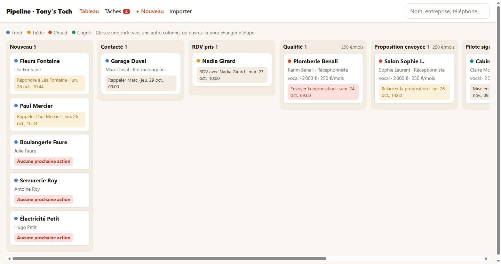
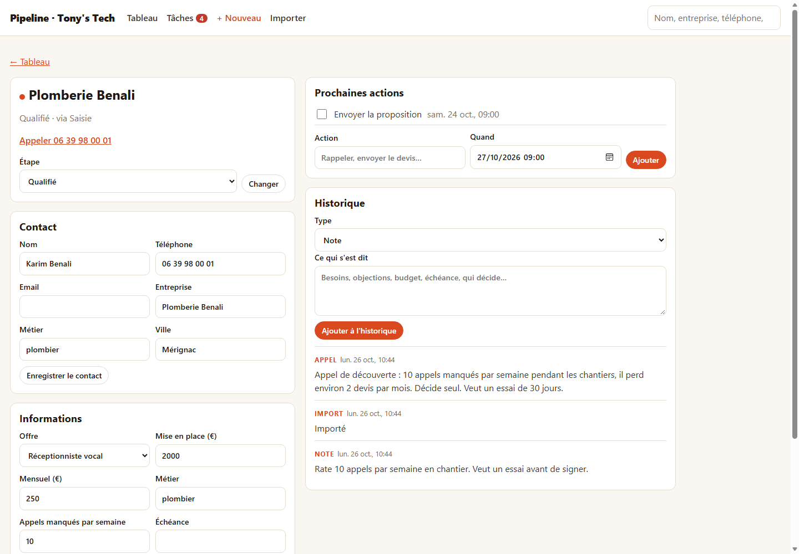

# open-pipeline

A small sales pipeline for a one-person business, on the Cloudflare free tier: contacts, deals moving
through stages, a next action on every deal, a timeline of what was said, and a morning email of what
to do today. Prospects come in by themselves from Cal.com bookings, from an AI phone receptionist
([open-receptionist](https://github.com/tonystechofficial/open-receptionist)), from a website form,
or from a CSV file. The interface is in French.



## What it does

- **Board**: the deals by stage, cold, warm or hot from their stage, the monthly amount per column.
  Drag a card to another column with a mouse; on a phone, change the stage from the deal page.
- **Deal page**: the contact, the custom fields (offer, amounts, the qualification questions), the
  next actions, and the timeline: notes, calls, meetings, emails, bookings, form messages, stage
  changes.
- **One rule against forgetting**: every open deal has a next action and a date. A deal without one
  is flagged on the board, on the tasks page and in the morning email.
- **Tasks**: overdue, today, coming, and the deals left without a next action.
- **Intake**, matched by phone and then by email, so the same person is never entered twice:
  - Cal.com bookings, moved or cancelled ones included: the deal goes to "RDV pris";
  - each call to the receptionist: "Nouveau", or "RDV pris" when the caller booked;
  - the website form: "Nouveau", with "Répondre à …" due now;
  - a CSV export from Excel, Google Sheets or Brevo (UTF-8 or Windows-1252), and manual entry.
- **"Perdu / Plus tard"** asks why, and when to get back in touch: that date becomes a task.
- **The morning email**, around 7 a.m. in Paris: what is overdue, what is due today, the deals
  without a next action. It can also be sent on demand from the tasks page.
- **Retention**: each morning, contacts untouched for three years that have no open deal and were
  never clients are deleted, with their deals and timeline.



## How it is built

Two Workers share one D1 database, created in the EU jurisdiction.

| Worker | Serves | Protection |
|---|---|---|
| `open-pipeline` | the pages, the API, the morning run (cron) | Cloudflare Access. The Worker also refuses every request that Access did not authenticate (`ctx.access`), so it stays closed if Access is ever switched off. |
| `open-pipeline-intake` | `/intake/calcom`, `/intake/receptionist`, `/intake/form`, `/health` | Public. Each endpoint checks its own proof: Cal.com's HMAC signature, a shared secret, or a Turnstile token from an allowed website. An endpoint whose secret is not set refuses everything. |

Access protects a whole Worker and cannot leave one path public, hence the second Worker. The pages
are plain HTML, CSS and JavaScript served by the app Worker under a strict content security policy:
no external script, no dependency. The tests use Node's test runner, with the real SQL on Node's
SQLite.

## What it costs

Nothing at this scale, on free plans: Cloudflare Workers (100,000 requests a day), D1 (5 million rows
read and 100,000 written a day, 5 GB; the limits are per account and reset at 00:00 UTC), Access (up
to 50 users), Turnstile; Resend for the morning email (3,000 emails a month).

## Set it up

You need Node 22 or later and a Cloudflare account.

```bash
git clone https://github.com/tonystechofficial/open-pipeline.git
cd open-pipeline
npm test                                                  # all green before anything else
npx wrangler login
npx wrangler d1 create open-pipeline --jurisdiction eu    # EU storage: set at creation, never after
npm run db:id                                             # creates wrangler.toml and wrangler.intake.toml, with the database id
npm run db:init                                           # the tables
```

Then your values. Git ignores both wrangler files: they hold this deployment's values.

- `wrangler.toml`, `[vars]`: `REMINDER_EMAIL`, who gets the morning email.
- `wrangler.intake.toml`, `[vars]`: `FORM_ORIGINS`, your website's address, such as `https://www.example.com`.
- `config/pipeline.json`: the business name, the stages, the fields ([Configuration](#configuration)).

```bash
npm run deploy    # both Workers; then README.local.md, the steps below with your own addresses
```

The steps that follow need you, once each. `README.local.md` spells them out with your addresses:

1. **Lock the app with Cloudflare Access**, in the dashboard: Workers & Pages > `open-pipeline` >
   **Access** > **Protect this Worker behind Access** > **All traffic**, policy **Cloudflare
   account**. Protect this Worker only: **Protect all Workers** would also lock the intake and the
   receptionist, whose callers cannot sign in. Never use the **Email domain** policy with a public
   domain such as gmail.com: every address on it could sign in.
2. **The morning email**: `npx wrangler secret put RESEND_API_KEY`, then **Tâches** > **M'envoyer
   le récapitulatif maintenant**. Resend's test sender delivers only to your Resend account's address.
3. **Cal.com**: `npm run cal:webhook` creates the webhook and its signing secret.
4. **The receptionist**: `npm run link:receptionist -- ../open-receptionist`, then `npm run deploy`
   in open-receptionist.
5. **The website form**: a Turnstile widget for your site (dashboard > Turnstile > Add widget), then
   `npx wrangler secret put TURNSTILE_SECRET -c wrangler.intake.toml` with its secret key.

To update a running deployment: `git pull`, `npm test`, `npm run db:init` (applies any new migration),
copy into your wrangler files any new setting of the `.example` templates, then `npm run deploy`.

## Configuration

`config/pipeline.json` describes the pipeline. The Worker checks it when it starts, and
`npm run deploy` refuses a file with a mistake, saying which.

- `name`, `timeZone`, `retentionDays` (1095 by default: three years, the CNIL's guideline for
  prospects).
- `stages`, in order: `id`, `label`, and for an open stage its `temperature` (`froid`, `tiede`,
  `chaud`). `won: true` marks a won stage; `closed: true` a stage that ends the deal (its open tasks
  are completed, and it leaves the board after 30 days). Exactly one stage has `lost: true`: moving a
  deal there asks for a reason and an optional date to get back in touch.
- `fields`: `id`, `label`, `type` (`text`, `number`, or `select` with `options: [{ id, label }]`).
- `sources`: the stage each intake starts a deal at (`calcom`, `receptionniste` with `bookedStage`,
  `formulaire`, `import`, `manuel`). A field whose `id` matches a Cal.com booking question's
  identifier is filled from the answer.

## The website form

The form posts JSON to `https://open-pipeline-intake.<you>.workers.dev/intake/form` from one of the
`FORM_ORIGINS`, with the Turnstile token. A name, and a phone or an email, are required.

```html
<form id="contact">
  <input name="name" required placeholder="Nom">
  <input name="phone" type="tel" placeholder="Téléphone">
  <input name="email" type="email" placeholder="Email">
  <input name="company" placeholder="Entreprise">
  <textarea name="message" placeholder="Votre message"></textarea>
  <input name="website" tabindex="-1" autocomplete="off" aria-hidden="true" style="position:absolute;left:-9999px">
  <div class="cf-turnstile" data-sitekey="YOUR_SITE_KEY"></div>
  <button>Envoyer</button>
  <p id="contact-status" role="status"></p>
</form>
<script src="https://challenges.cloudflare.com/turnstile/v0/api.js" async defer></script>
<script>
  document.getElementById('contact').addEventListener('submit', async (event) => {
    event.preventDefault();
    const fields = Object.fromEntries(new FormData(event.target));
    fields.turnstileToken = fields['cf-turnstile-response'];
    const res = await fetch('https://open-pipeline-intake.<you>.workers.dev/intake/form', {
      method: 'POST', headers: { 'content-type': 'application/json' }, body: JSON.stringify(fields),
    });
    const answer = await res.json().catch(() => ({}));
    document.getElementById('contact-status').textContent = res.ok ? 'Merci, nous vous répondons vite.' : answer.error;
  });
</script>
```

The `website` field is a trap for robots: hidden from people, a request that fills it is dropped
silently. The answers: `200` received; `400` with a French message to show (no name, or no way to
answer); `403` website not allowed, or Turnstile failed; `503` while `TURNSTILE_SECRET` is not set.

## The receptionist's calls

`open-receptionist` posts the end of each call to `/intake/receptionist` with the shared secret in
`x-pipeline-secret`. Another tool can send the same shape:

```json
{
  "callId": "call_123",
  "endedAt": "2026-10-26T10:00:00.000Z",
  "status": "rdv",
  "caller": { "nom": "Jean Dupont", "telephone": "+33639980001", "email": null, "besoin": "un devis", "urgence": "normale", "ville": "Mérignac" },
  "appointment": { "at": "2026-10-28T08:00:00.000Z", "label": "mercredi 28 octobre à 9 h" },
  "summary": "Veut un devis pour sa salle de bain."
}
```

`status` is `rdv` (with `appointment`) or `a_rappeler` (`appointment: null`). A call is recorded once
however often it is sent. When the receptionist books through Cal.com and both report the same
appointment, the deal gets one task.

## Develop locally

```bash
npm run db:init:local
npm run dev           # the app on http://127.0.0.1:8787, signed in as [access.dev] in wrangler.toml
npm run dev:intake    # the intake on http://127.0.0.1:8788, sharing the local database
```

Local secrets go in `.dev.vars` (ignored by git), which also overrides `[vars]` during `wrangler dev`:

```
CALCOM_WEBHOOK_SECRET=any-local-value
RECEPTIONIST_SECRET=any-local-value
TURNSTILE_SECRET=1x0000000000000000000000000000000AA
FORM_ORIGINS=http://localhost:8790
```

The Turnstile secret above is Cloudflare's test key that always passes.

## Commands

| Command | What it does |
|---|---|
| `npm test` | all the tests |
| `npm run db:id` | writes the database id into both wrangler files (creates them the first time) |
| `npm run db:init` | applies the migrations to the deployed database (`db:init:local` for the local one) |
| `npm run deploy` | checks the configuration, deploys both Workers, writes `APP_URL` and `README.local.md` |
| `npm run cal:webhook` | creates or updates the Cal.com webhook, with a new signing secret |
| `npm run link:receptionist -- <folder>` | links open-receptionist: a shared secret on both Workers, `CRM_WEBHOOK_URL` in its wrangler.toml |
| `npm run dev`, `npm run dev:intake` | both Workers locally |
| `npm run tail`, `npm run tail:intake` | the deployed Workers' logs, the morning run included |

## Data and privacy

- The database is created in the EU jurisdiction: its data stays in the EU.
- It holds what a sales follow-up needs: the contact (name, phone, email, business, trade, town),
  the deals and their fields, the tasks and the timeline. The receptionist never sends a street
  address.
- Contacts untouched for `retentionDays`, with no open deal and never clients, are deleted every
  morning.
- Secrets are set with `wrangler secret put`, never written in a file of this repository; the setup
  commands give them to wrangler without printing them.

## License

MIT
